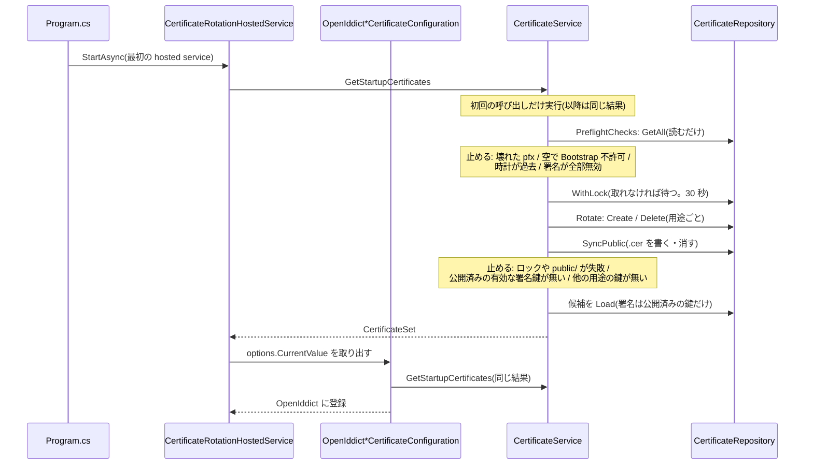
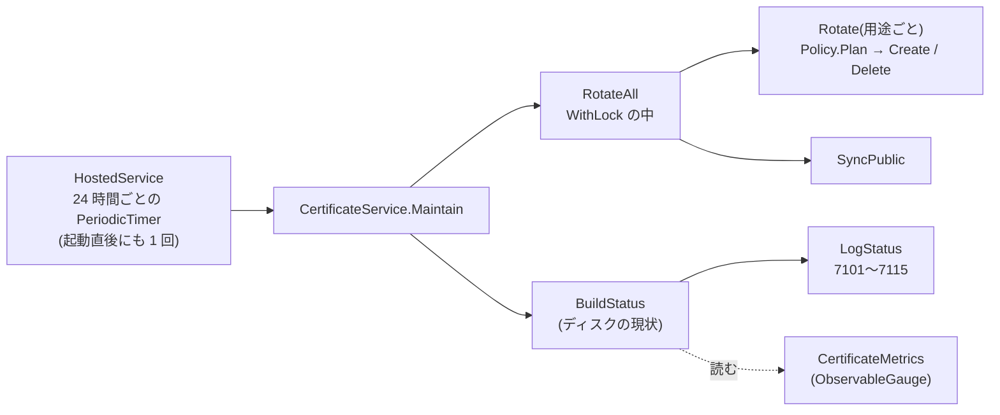

# 証明書の自動ローテーションと運用手順

出勤台 IdP の証明書(署名・暗号化)は、出勤台が自動で作り、切り替え、古いものを消す。この文書は、その仕組みと、人がやること(再起動、監視、緊急時の手順)をまとめる。Crew と TTC 側の読み込み方は `Docs/authentication.md` の「署名公開鍵の受け取り方」を参照。

前提(2026-11-07 に決定済み):

- Crew と TTC は出勤台と**同じホスト**で動く。出勤台の `cert/public/`(`.cer` だけ)を読み取り専用でマウントして、検証鍵にする。人が `.cer` を配る工程は無い。
- 証明書の切り替えは**再起動のときだけ**。動いているプロセスの OpenIddict の options は作り直さない。運転会をやっていないときに、人が手動で再起動する。
- 有効な署名証明書が 1 つも無ければ、**起動を止める**(黙って新しい鍵を作って起動することはしない)。
- 用途のディレクトリに pfx が 1 つも無いとき(初回)も、**起動を止める**。鍵を作って起動するのは、設定 `Authentication:AllowCertificateBootstrap=true` を付けたときだけ(既定は false)。`cert/` のマウント漏れで空のボリュームになったとき、黙って新しい署名鍵で起動し、Crew と TTC が全員 401 になるのを防ぐため。次の鍵の自動生成(ローテーション)は、この設定に関係なく行う。
- 署名は、`cert/public/` に**同じ内容の `.cer` がある鍵でしか署名しない**(Crew と TTC が一度も見ていない鍵では署名しない)。起動時に `public/` を同期できなければ、起動を止める。
- インスタンスは 1 つ。複数にする場合の注意は「複数インスタンスにするとき」を参照。

## 用途と寿命

| 用途 | 何に使うか | 寿命 | 次を作る時期 | 次の鍵の NotBefore | 古い鍵を消す時期 | 期限切れで止まるか |
|---|---|---|---|---|---|---|
| `server-signing` | アクセストークンの署名(JWKS と `cert/public/` で公開) | 2 年 | 最も遠い NotAfter まで残り 150 日 | 期限の 60 日前(未来。公開だけ先にする) | NotAfter + 7 日 | **起動時に止まる**(有効な鍵が無いとき) |
| `server-encryption` | refresh token と authorization code の暗号化 | 2 年 | 残り 60 日 | すぐ(今 − 5 分) | NotAfter + 14 日 | 起動時に止まる(有効な鍵が無く、作成にも失敗したとき。期限切れだけなら自動で作り直す) |
| `client-signing` | Discord ログインの state token の署名 | 2 年 | 残り 60 日 | すぐ | NotAfter + 1 日 | 止まらない |
| `client-encryption` | 同、暗号化 | 2 年 | 残り 60 日 | すぐ | NotAfter + 1 日 | 止まらない |

- 暗号化の古い鍵を NotAfter + 14 日まで残すのは、それで暗号化された refresh token(寿命 7 日)を復号するため。期限切れの証明書でも、復号には使える。先に消すと、その refresh token は `invalid_grant` になり、利用者は再ログインになる。
- Client 用の古い鍵を NotAfter + 1 日で消すのは、state token の寿命が 15 分だから。
- 古い鍵を消すのは、NotAfter + 保持期間を過ぎ、**かつ、このプロセスの起動から保持期間がたっている**とき(両方)。再起動を長く怠ったあとの起動で、直前まで使っていた鍵(と `.cer`)を、起動の最初に消さないため。再起動の直後は、期限を過ぎた鍵も保持期間の間は残る。
- 「最も遠い NotAfter」は、NotBefore が未来の鍵も含めて数える。次の鍵を作った後は、残りが約 2 年になるので、重複して作らない。

## 署名証明書のタイムライン

現在の鍵の NotAfter を E とする。

```
E-150日  次の鍵を自動生成(NotBefore = E-60日、NotAfter = NotBefore + 2 年)。JWKS と cert/public/ に載る
         (ログ: CertificateCreated(7104) Warning。以後、毎日 NextSigningCertificatePending(7103))
         → Crew と TTC は、切り替え(E-60日)までに、cert/public/ の新しい .cer を読み込む(= 再起動か、定期的な再読み込み)
E-60日   次の鍵の NotBefore を過ぎる。OpenIddict は、再起動のときから次の鍵で署名する
         (動いているプロセスは古い鍵のまま。ログ: RestartRequired(7105)、メトリクス restart_required = 1)
         → 運転会のない日に、出勤台を再起動する。ここから E までの 60 日間が、再起動の期限
E        古い鍵が期限切れ(動いているプロセスは、期限切れの鍵でも署名を続ける。Crew と TTC は鍵の期限を見ない)
E+7日    古い鍵の pfx と .cer を削除(ただし、動いているプロセスが使っているものは、再起動まで消さない)
```

- 生成が遅れた場合(出勤台が長く止まっていた、など): NotBefore = max(E-60日, 今 + 14 日)。ただし E-1 日より後にはしない。猶予が 14 日に満たなかったときは、CertificateCreated が Error になる。
- 署名証明書がすべて期限切れ(または NotBefore が未来のものだけ)になっていたら、新しい鍵は作らず、起動を止める。対処は「全部期限切れで起動しないとき」。
- 時刻はコンテナのクロックではなく、アプリの `TimeProvider`(通常はシステム時刻)で決まる。OpenIddict も同じ時計を使う。

## ファイルのレイアウトと権限

```
cert/                                            0700   Authentication:CertificateDirectory(Docker では /app/cert。永続化する)
  .rotation.lock                                 0600   排他ロック(複数のプロセスが同時に作らないため。消えていても問題ない)
  server-signing/20261107T000000Z-ACBE7005.pfx   0600   {NotBefore}-{Thumbprint 先頭 8 桁}.pfx。パスワードなし。ディレクトリは 0700
  server-encryption/*.pfx
  client-signing/*.pfx
  client-encryption/*.pfx
  public/server-signing-{Thumbprint}.cer         0644   署名用の公開鍵だけ(DER)。ディレクトリは 0755。Crew と TTC が読む
```

- `public/` には、署名用の pfx が残っている間の `.cer` だけを置く(現在の鍵、次の鍵、期限後 7 日以内の古い鍵)。pfx を消すと `.cer` も消える。pfx は決して `public/` に置かない。
- ファイルは原子的に書く(同じディレクトリに `.{guid}.tmp` を書いて flush してから move)。`*.cer` は、完成したものか、存在しないかのどちらかしか見えない。`*.tmp` は読まれず、1 日以上前のものは自動で消える。
- 起動のたびに、`public/` を署名用の pfx と照合する。`.cer` が無い・内容が違う場合は書き直し、余分な `.cer` は消す。
- 権限が想定より緩い(既存のディレクトリやファイルも含む。直しはしない)と、状態のログに `CertificatePermissionTooOpen`(7108)の Warning が出る。`public/` に `.cer` と一時ファイル以外(特に pfx)があれば、`UnexpectedPublicFile`(7113)の Warning が出る。
- `Authentication:CertificateDirectory` が相対パスのときは、起動時に `CertificateDirectoryIsRelative`(7112)の Warning を、解決された絶対パスつきで出す。本番では絶対パスにすること。
- Docker で bind mount するときは、ホスト側の `cert/` の所有者をコンテナのユーザー(`$APP_UID`、既定 1654)にする。例: `mkdir cert && sudo chown 1654:1654 cert && chmod 700 cert`。

## 初回のデプロイ

初回は `cert/` が空なので、鍵を作らせるために `Authentication:AllowCertificateBootstrap=true` を付けて起動する。

1. `cert/` のホスト側ディレクトリを、コンテナのユーザー(UID 1654)の所有で作る: `mkdir idp-cert && sudo chown 1654:1654 idp-cert && chmod 700 idp-cert`。compose の `volumes` に `./idp-cert:/app/cert` があることを確かめる(書き忘れると空のボリュームになる)。
2. `Authentication__AllowCertificateBootstrap=true` を付けて起動する。4 用途の鍵が作られ(`CertificateCreated` 7104 が Warning で 4 件)、`idp-cert/public/` に `.cer` が 1 つできる。
3. **確認したら、`AllowCertificateBootstrap` を外して(または false にして)再起動する**。以後、`cert/` が空のまま起動すると、止まって知らせてくれる。
4. Crew と TTC に `idp-cert/public/` を読み取り専用でマウントして起動する。

## 再起動の運用

動いているプロセスは、起動時に選んだ証明書を使い続ける。切り替えは再起動のときだけで、再起動が必要になると、出勤台がログとメトリクスで知らせる。

いつ再起動するか:

- `RestartRequired`(7105)のログ、またはメトリクス `shukkindai.certificate.restart_required` が 1 になったら、次に運転会がない日に再起動する。
  - 署名: E-60 日から。期限(E)までの約 60 日が猶予。
  - 暗号化・Client: 新しい鍵を作った日から(作成は残り 60 日で、作った時点で使うべき鍵が切り替わる。24 時間以内にログに出る)。
- 再起動を急ぐ目安は、使用中の鍵の残りが 30 日を切ったとき(7105 が Error になる)。
- 再起動の前に、Crew と TTC が次の `.cer` を読み込み済みであること(切り替えの 90 日前に `public/` に置かれるので、通常は問題ない)。読み込み済みか分からないときは、Crew と TTC を先に再起動する。

再起動の手順と確認:

1. 運転会がないことを確認する(再起動中は認証できない。起動時に Discord と同期するため、30 秒程度かかることがある)。
2. 出勤台を再起動する(例: `docker compose restart idp`)。
3. 起動ログを確認する。
   - `StartupCertificatesLoaded`(7109)が用途ごとに出て、`ActiveThumbprint` が新しいものになっている。
   - `CertificateSetStatus`(7102)の `ActiveThumbprint` が新しい鍵になり、`RestartRequired`(7105)が出なくなる。
4. 新しくログインして、アクセストークンの header の `kid` が新しい鍵の Thumbprint であることを確認する。Crew と TTC でそのトークンが通ること。
5. メトリクスの `shukkindai.certificate.restart_required` が 0 に戻ること。

古いアクセストークン(最長 1 時間)は、古い鍵で署名されている。Crew と TTC は古い `.cer` もまだ持っている(期限後 7 日まで `public/` にある)ので、そのまま通る。

## ログ

`[LoggerMessage]` で EventId を固定している(アラートで数値を使うため、変えない)。カテゴリは `Tatehama.Shukkindai.Server.Services.CertificateService`。状態のログは起動時と 24 時間ごと(`CertificateRotationHostedService`)。

日時のプロパティは、カルチャに依存しないよう ISO 8601("O" 形式、UTC)の文字列で渡す。残り日数は切り捨ての整数(期限切れは負)。

| EventId / Name | レベル | メッセージ(プロパティ) |
|---|---|---|
| 7101 `CertificateStatus` | Information(証明書ごと) | `CertificatePurpose`、`CertificateThumbprint`、`CertificateState`(`Active`=使用中 / `Pending`=NotBefore が未来 / `Standby`=有効だが未使用 / `Expired`)、`NotBefore`、`NotAfter`、`RemainingDays` |
| 7102 `CertificateSetStatus` | 下の表 | 用途ごと。`ActiveThumbprint`(このプロセスが使っている鍵)、`UsableUntil`、`RemainingDays`(使用中の鍵の残り)、`NewestNotAfter`、`NewestRemainingDays`(ディスク上で最も遠い NotAfter までの残り)、`SuccessorExists`(使用中の鍵より NotAfter が遠い、期限内の鍵がある) |
| 7103 `NextSigningCertificatePending` | Information。切り替えまで 14 日以内なら Warning | 次の署名鍵がある間、毎日。`CertificateThumbprint`、`ActivatesAt`、`DaysUntilActivation`、`CerFileName` |
| 7104 `CertificateCreated` | 署名の次の鍵と、初回の生成(`AllowCertificateBootstrap`)は Warning(猶予が 14 日に満たなければ Error)。それ以外は Information | `CertificatePurpose`、`CertificateThumbprint`、`NotBefore`、`NotAfter` |
| 7105 `RestartRequired` | Warning。使用中の鍵の残りが 30 日以内なら Error | 使うべき鍵と、プロセスが使っている鍵が違う。`CertificatePurpose`、`CertificateThumbprint`(使うべき鍵)、`PreviousThumbprint`(使用中)、`PreviousNotAfter`、`RemainingDays`。**毎日出る(再起動するまで)** |
| 7106 `CertificateDeleted` | Information | `CertificatePurpose`、`CertificateThumbprint`、`NotAfter` |
| 7107 `CertificateRotationFailed` | Error(例外つき) | `CertificatePurpose`(`server-signing` など、`public`、`all`) |
| 7108 `CertificatePermissionTooOpen` | Warning | `Path`(権限が想定より緩い) |
| 7109 `StartupCertificatesLoaded` | Information | 起動時、用途ごと。`CertificateCount`、`ActiveThumbprint` |
| 7110 `NoValidSigningCertificate` | Critical | 有効な署名証明書が無く、起動を止めた(この直後に例外) |
| 7111 `PublicCertificatesChanged` | Information | `public/` に書いた(`+`)・消した(`-`)`.cer` |
| 7112 `CertificateDirectoryIsRelative` | Warning | `ConfiguredPath`、`ResolvedPath`(本番で相対パス) |
| 7113 `UnexpectedPublicFile` | Warning | `FileName`(`public/` にある、`.cer` 以外のファイル) |
| 7114 `CertificateDirectoryEmpty` | Error | `CertificatePurpose`、`Directory`(動作中に、用途のディレクトリから pfx が全部消えた。鍵は作らない。次の再起動で起動に失敗する。ローテーションの失敗として扱い、最終成功時刻は進まない) |
| 7115 `InUseSigningCertificateMissing` | Error | `Thumbprint`、`Directory`(このプロセスが署名に使っている鍵の pfx が、動作中に消えた。複数のうち 1 つだけ消えたときも出る。`.cer` は再起動まで `public/` に残す。次の再起動ではこの鍵は使えない。24 時間ごとの実行のたびに出る) |

7102 のレベル(何を人に知らせるかで決めている。再起動すれば済む話は、上げすぎない):

| 使用中の鍵の残り | 次の鍵(使用中より NotAfter が遠い鍵)がある | 次の鍵が無い |
|---|---|---|
| 90 日超 | Information | Information |
| 30 日超〜90 日 | Information | **Warning**(自動ローテーションが追いついていない) |
| 0 日超〜30 日 | Warning | **Critical**(人が対応しないと、再起動したときに起動できなくなる) |
| 0 日以下(期限切れ) | Error(再起動すれば直る) | **Critical** |

「再起動が必要」という事実そのものは 7102 ではなく 7105 で知らせる(使用中の鍵の残りが 30 日を超えていれば Warning、30 日以内なら Error)。

## メトリクス(OpenTelemetry)

`OTEL_EXPORTER_OTLP_ENDPOINT` が設定されているときだけ、OpenTelemetry が有効になる(Crew と同じ)。有効なときの内容:

- ASP.NET Core と HttpClient の metrics と tracing
- ログの OTLP 出力(`IncludeFormattedMessage`、`IncludeScopes`)
- 自前の Meter `Tatehama.Shukkindai.Server.Certificates`(下の表)

その他の設定は OpenTelemetry の標準の環境変数で行う(`OTEL_EXPORTER_OTLP_PROTOCOL`、`OTEL_EXPORTER_OTLP_HEADERS`、`OTEL_SERVICE_NAME` など)。`OTEL_SERVICE_NAME=tatehama-shukkindai` を付けること(未設定だと `unknown_service` になる)。

自前のメトリクスは、すべて ObservableGauge。読み取られた時点の時刻で計算するので、1 日 1 回の更新を待たずに値が連続して変わる。tag は用途だけ(`certificate.purpose` = `server-signing` / `server-encryption` / `client-signing` / `client-encryption`。カーディナリティは 4)。

| メトリクス名 | 型 | 単位 | tag | 意味 |
|---|---|---|---|---|
| `shukkindai.certificate.remaining_time` | ObservableGauge(double) | `s` | `certificate.purpose` | このプロセスが使っている証明書の NotAfter までの残り。期限切れは負 |
| `shukkindai.certificate.newest_remaining_time` | ObservableGauge(double) | `s` | `certificate.purpose` | ディスク上で最も遠い NotAfter までの残り。自動ローテーションが動いていれば、署名は 140 日、他は 50 日を下回らない |
| `shukkindai.certificate.restart_required` | ObservableGauge(int) | `{bool}` | `certificate.purpose` | 1: 今の時刻で使うべき証明書が、プロセスの使用中のものと違う(再起動すれば切り替わる) |
| `shukkindai.certificate.next_signing.exists` | ObservableGauge(int) | `{bool}` | なし | 1: NotBefore が未来の署名鍵(次の鍵)がある |
| `shukkindai.certificate.next_signing.activation_time` | ObservableGauge(double) | `s` | なし | 次の署名鍵が有効になるまで。次の鍵がある間だけ出る |
| `shukkindai.certificate.rotation.last_success_timestamp` | ObservableGauge(double) | `s` | なし | 全用途のローテーションが成功した最後の時刻(Unix 時刻の秒) |

- Prometheus 互換に変換されると、名前の `.` は `_` に、単位 `s` は `_seconds` の接尾辞になる想定(例: `shukkindai_certificate_remaining_time_seconds{certificate_purpose="server-signing"}`)。実際の名前は送り先の設定(変換方式)で変わりうるので、Grafana の Explore で確かめること(この実装では確かめていない)。
- Development 環境では、証明書の管理自体が無効(開発用の証明書を使う)なので、これらのメトリクスは出ない。

## Grafana のアラート設計

送り先が Prometheus 互換かどうかは**未確定**。以下は PromQL を想定したクエリで、Loki や別のバックエンドなら、同じ条件に読み替える。評価間隔は 1 分〜1 時間でよい(数日単位の話)。ラベル `service_name` などは収集の設定次第なので、必要に応じて絞り込みを足す。

| # | 名前 | 条件(PromQL) | 継続 | 重大度 | 人がやること |
|---|---|---|---|---|---|
| A1 | 署名: 自動ローテーションが追いついていない | `shukkindai_certificate_newest_remaining_time_seconds{certificate_purpose="server-signing"} < 140 * 86400` | 1h | Warning | 7107 のログで失敗の原因を調べる。「自動化が止まっていたとき」 |
| A2 | 署名: 期限が近い | `shukkindai_certificate_newest_remaining_time_seconds{certificate_purpose="server-signing"} < 30 * 86400` | 5m | Critical | 同上。さらに、猶予が短いので急ぐ |
| A3 | 暗号化・Client: 自動ローテーションが追いついていない | `shukkindai_certificate_newest_remaining_time_seconds{certificate_purpose!="server-signing"} < 50 * 86400` | 1h | Warning | 同上 |
| A4 | 暗号化・Client: 期限が近い | `shukkindai_certificate_newest_remaining_time_seconds{certificate_purpose!="server-signing"} < 14 * 86400` | 5m | Critical | 同上 |
| B1 | 再起動が必要(未実施) | `shukkindai_certificate_restart_required == 1` | 24h | Warning | 次の運転会がない日に再起動する |
| B2 | 再起動が必要で、使用中の鍵の期限が近い | `shukkindai_certificate_restart_required == 1 and on (certificate_purpose) shukkindai_certificate_remaining_time_seconds < 30 * 86400` | 5m | Critical | 早めに再起動する(運転会があっても、短時間で済ませる) |
| B3 | 使用中の鍵が期限切れ | `shukkindai_certificate_remaining_time_seconds < 0` | 5m | Critical | 再起動(次の鍵があれば直る。無ければ手順書) |
| C1 | ローテーションの成功が古い | `time() - shukkindai_certificate_rotation_last_success_timestamp_seconds > 3 * 86400` | 1h | Warning | 7107 のログを見る。ディスク・権限・ロック |
| C2 | ローテーションの成功がとても古い | `time() - shukkindai_certificate_rotation_last_success_timestamp_seconds > 7 * 86400` | 5m | Critical | 同上 |
| C3 | メトリクスが来ない(出勤台が止まっている、OTLP が届いていない。**起動時のローテーションが失敗した場合にも鳴る**: 最終成功時刻が一度も出ないため) | `absent(shukkindai_certificate_rotation_last_success_timestamp_seconds)` | 30m | Critical | 出勤台のプロセスと OTLP の経路を確認する |
| D1 | 次の署名鍵の切り替えが近い | `shukkindai_certificate_next_signing_activation_time_seconds < 14 * 86400` | 1h | Info(または Warning) | Crew と TTC が次の `.cer` を読み込み済みか確認する。その後、再起動の計画 |

補足:

- A 系は「ローテーション自体が止まった」ことの検知。正常なら、署名の newest は常に 140 日超(150 日を切った日に次の鍵ができて、約 2 年に戻る)、他は 50 日超。
- B 系は「人が再起動する」ことの検知。B1 は再起動するまで鳴り続ける。再起動すると 0 に戻る。
- C 系は、アラート自体が働いていることの保険。A 系は自動化が止まったときに値が下がるので鳴るが、プロセス全体が止まるとメトリクスが出なくなる(C3)。
- Grafana のアラートの「No Data」は、C3 以外では Normal 扱いにする(A・B は値が来ているときだけ判定する)。
- 用途ごとに通知先を分ける必要はない(`certificate_purpose` をラベルとして通知に含めれば足りる)。
- `/healthz` には含めない。証明書の期限や再起動の要否は、今リクエストを受けられるかとは別の話で、503 にするとロードバランサーから外れて自分で障害を起こす。

### ログでの代替(Loki)

メトリクスを使わない場合や、メトリクスの補助として。ログの形式は 2 通りある(どちらを送るかは未確定)。

1. **JSON console**: `Logging__Console__FormatterName=json` で標準出力を 1 行の JSON にして、Alloy / Promtail で Loki に送る。EventId は数値(`"EventId":7102`)で、Name は出ない。プロパティは `State` の中に入る(`State.CertificatePurpose`、`State.RemainingDays` など)。
2. **OTLP でログを送る**: Loki の OTLP 取り込みでは、ログの属性(`CertificatePurpose`、`RemainingDays` など)が structured metadata になる。

クエリの例(LogQL。ラベル名は収集の設定次第で、実際の取り込みでは確かめていない):

```logql
# 用途ごとの、使用中の鍵の直近の残り日数(JSON console の場合)。< 90 で Warning、< 30 で Critical
min by (purpose) (
  last_over_time(
    {service="tatehama-shukkindai"}
      | json event_id="EventId", purpose="State.CertificatePurpose", remaining="State.RemainingDays"
      | event_id = "7102"
      | unwrap remaining [26h]
  )
)
```

```logql
# 状態のログが 26 時間出ていない(出勤台が止まっている、HostedService が死んでいる)
absent_over_time({service="tatehama-shukkindai"} | json event_id="EventId" | event_id = "7102" [26h])
```

```logql
# 再起動が必要(7105)、ローテーションの失敗(7107)、起動の停止(7110)、ディレクトリが空(7114)、使用中の署名の pfx が消えた(7115)が 1 件でもあれば通知
sum(count_over_time({service="tatehama-shukkindai"} | json event_id="EventId" | event_id =~ "7105|7107|7110|7114|7115" [1h]))
```

- ログでは、ログレベルでも絞り込める(7102 は上の表のレベルで出るので、`LogLevel = "Critical"` の 7102 は「次の鍵が無く、期限が近い」)。
- 動作中に pfx が消えた(7114、Error)ときは、メトリクスの `last_success_timestamp` が進まなくなる(C1 は 3 日後、C2 は 7 日後)ので、気づくのが遅い。早く知りたければ、上の LogQL の 7114・7115 で通知する(Grafana のアラートはメトリクスだけでは拾えない)。
- 評価間隔は 1 時間、範囲は 26 時間(1 日 1 回のログを取りこぼさない)。

## 手順書(Runbook)

用語: 「証明書のディレクトリ」は `cert/`(Docker では `/app/cert` にマウントしたホスト側のディレクトリ)。

スクリプト(`Server/tools/`。.NET 10 の file-based app)は、Docker では次の形で実行する。**出勤台のコンテナのユーザー(UID 1654)で実行すること**。

```
# kid と期限(読み取りだけ)。<cert> はホスト側の cert ディレクトリ(例: ./idp-cert)
docker run --rm -u 1654 -v "$PWD/idp-cert:/c:ro" -v "$PWD/Server/tools:/t:ro" mcr.microsoft.com/dotnet/sdk:10.0 \
  sh -c 'dotnet run /t/inspect-cert.cs -- /c/server-signing/*.pfx /c/public/*.cer'

# 鍵を作る(pfx だけ。:ro を付けない)
docker run --rm -u 1654 -v "$PWD/idp-cert:/c" -v "$PWD/Server/tools:/t:ro" mcr.microsoft.com/dotnet/sdk:10.0 \
  dotnet run /t/gen-cert.cs -- server-signing /c 2027-08-01T00:00:00Z
```

注意:
- **所有者**: `-u 1654` を付けないと root で作られ、出勤台(UID 1654)が読めなくなる。root や `sudo` で `cert/` の中身を作った・コピーした場合は、`sudo chown -R 1654:1654 idp-cert` で直す(ディレクトリ 0700、pfx 0600、`public/` 0755、`.cer` 0644 を保つ)。出勤台が読めないと、`permission denied` のメッセージで起動に失敗する。
- **グロブ**: `*.pfx` はシェルが展開する。上の例のように `sh -c '...'` の中に書けば、コンテナ側で展開される(コンテナの外で書くと、ホスト側のパスとして展開されて、何も一致しない)。
- `gen-cert.cs` は、出勤台と同じく用途のディレクトリを 0700 で作り、一時ファイルに書いてから move し、`cert/.rotation.lock` を取る。寿命は出勤台と同じ 730 日。出勤台が動いているときに実行しても、ロックで直列化される。
- ホストに .NET 10 SDK があるなら、`dotnet run Server/tools/inspect-cert.cs -- <ファイル>...` でも同じ(その場合も、所有者に注意)。
- OpenSSL でも確認できる: `openssl x509 -in x.cer -inform der -noout -dates -fingerprint -sha1`(fingerprint の `:` を除いたものが kid)。

### 0. 事前確認(どの手順でも最初に)

1. 今の証明書の一覧と期限を確かめる(上の `inspect-cert.cs` の `docker run`)。
2. JWKS(`{issuer}.well-known/jwks`)の `kid` と一致することを確かめる。
3. 出勤台のログで、直近の `CertificateSetStatus`(7102)と `RestartRequired`(7105)を見る。
4. 作業前に `cert/` を丸ごとバックアップする(権限を保つ: `sudo cp -a idp-cert idp-cert.bak`)。バックアップは作業後に消す(秘密鍵のコピーを増やさない)。
   - **バックアップから戻すときは、`cert/` ディレクトリそのものを `mv` や `rm -rf` で差し替えない**。Crew と TTC が `cert/public` を bind mount していると、差し替え前の古い inode を指したままになり、新しい `.cer` が見えない。出勤台を止めて、**中身だけ**を戻す: `sudo rsync -a --delete idp-cert.bak/ idp-cert/`(rsync が無ければ、`find idp-cert -mindepth 1 -delete` のあと `sudo cp -a idp-cert.bak/. idp-cert/`)。戻したあと、所有者(1654)と権限を確かめ、Crew と TTC を再起動する(マウントを張り直す)。

### 1. 通常の再起動(切り替え)

「再起動の運用」を参照。

### 2. 緊急ローテーション(鍵の漏洩)

漏洩した鍵は**すぐ**撤去する。猶予期間は置かない。配り終えるまで Crew と TTC が 401 になることは受け入れる。

署名鍵が漏洩した場合:

1. 出勤台を停止する。
2. `cert/server-signing/` の pfx を全部消す(漏洩した鍵だけでなく、次の鍵も新しく作り直すほうが安全。次の鍵が漏洩していないと言い切れるなら、それは残してよい)。
3. `Authentication__AllowCertificateBootstrap=true` を付けて出勤台を起動する(ディレクトリが空だと、これが無いと起動しない)。**すぐ有効な新しい鍵**が作られ、`cert/public/` の `.cer` が入れ替わる(古い `.cer` は消える)。ログに `CertificateCreated`(7104、初回)と `PublicCertificatesChanged`(7111)が出る。確認したら、この設定を外して再起動する。
4. Crew と TTC に新しい `.cer` を読み込ませる(再起動)。古い `.cer` を信頼しなくなるので、漏洩した鍵で作られた偽のトークンは通らなくなる。
5. 利用者は、出勤台クライアントで取り直す(refresh で新しいアクセストークンが出る)。

暗号化鍵が漏洩した場合: `cert/server-encryption/` の pfx を全部消して再起動する。その鍵で暗号化された refresh token は使えなくなり、**全員が再ログイン**になる。refresh token の一括失効は MVP の範囲外(DB の `OpenIddictTokens` を直接消す、など別途検討)。

### 3. ロールバック(切り替えたら Crew/TTC で 401 が出た)

原因の例: Crew/TTC が次の `.cer` を読み込んでいない。

1. 出勤台を停止し、新しい鍵の pfx を `cert/server-signing/` から別の場所へ移す(消さない)。古い鍵が期限内であることを確かめる(`inspect-cert.cs`)。
2. 出勤台を起動する。古い鍵で署名するように戻る。このとき自動ローテーションが、次の鍵を新しく作る(猶予は最低 14 日。期限が近ければ短くなり、Error のログが出る)。
3. Crew と TTC が `cert/public/` の `.cer` を全部読み込んでいることを確認する(「署名公開鍵の受け取り方」)。
4. 移した pfx は、不要になったら安全に消す。
5. 新しい鍵で発行済みのトークン(最長 1 時間)は、Crew と TTC では通らない。利用者には取り直してもらう。

古い鍵がもう期限切れの場合は戻せない(起動を拒否される)。この状況にしないために、切り替えは期限の 60 日前に行う設計になっている。

### 4. 自動化が止まっていたときの復旧

症状: 7107 `CertificateRotationFailed` が出ている、メトリクス `rotation.last_success_timestamp` が古い、署名の `newest_remaining_time` が 140 日を切った(アラート A1〜A4、C1〜C2)。

1. 7107 の例外を見て、原因を取り除く。よくある原因:
   - `cert/` の権限・所有者(コンテナのユーザーが書き込めない)、ディスクの空き。
   - 壊れた pfx(`InvalidDataException`。例外メッセージにパスが出る)→ 「5. 壊れた pfx」。
   - `.rotation.lock` が取れない(`IOException`)。他のプロセスが持っている。ロックはプロセスが終わると自動で解放される。ファイルが残っていても問題ない。
2. 原因を直したら、出勤台を再起動する(起動時に 1 回、ローテーションが走る)か、次の 24 時間ごとの実行を待つ。
3. 署名の次の鍵が、猶予が短いまま作られた場合(CertificateCreated が Error)は、Crew と TTC に `public/` を早めに読み込ませる。
4. 期限が切れる前に直らない場合は、「全部期限切れで起動しないとき」の手順を使う。

### 5. 壊れた pfx

出勤台が `Certificate file ... could not be read as a PKCS#12 file` で起動に失敗する、または 7107 が出続ける。

1. 例外メッセージのパスのファイルを、別の場所へ移す(`.pfx` 以外の拡張子にしてもよい。調査後に消す)。
2. 出勤台を再起動する。残りの有効な鍵で起動し、足りない用途は自動で作られる。
3. 署名の pfx が 1 つも残らなかった場合は、「全部期限切れで起動しないとき」と同じ扱い(`AllowCertificateBootstrap=true` で新しい鍵を作る。Crew/TTC は読み込み直しが必要)。

### 5b. 動作中に pfx が消えた(7114・7115)

症状: 7114 `CertificateDirectoryEmpty`(Error。用途のディレクトリが空になったとき)または 7115(使用中の署名鍵の pfx が消えたとき)。動いているプロセスはメモリ上の鍵で動き続けるが、**このままだと次の再起動で起動に失敗する**。

1. **再起動しない**。バックアップから `cert/` の該当の用途のディレクトリを戻す(所有者 UID 1654、pfx 0600、ディレクトリ 0700 を保つ)。次の 24 時間ごとの実行で 7114・7115 が止まる。
2. 署名の pfx が消えたときは、7115 `InUseSigningCertificateMissing`(Error)も出る(署名の pfx が複数あって 1 つだけ消えたときは、7114 は出ず、7115 だけが出る)。このプロセスが署名に使っている鍵の `.cer` は、**再起動まで `public/` から消さない**ので、Crew/TTC は今のトークンを検証し続けられる。`.cer` も消えていたときは、メモリ上の証明書から書き戻す(`PublicCertificatesChanged` の `+`)。ただし、この鍵は次の再起動では使えない。pfx を戻す(手順 1)まで、7115 は 24 時間ごとに出続ける。
3. バックアップが無いときは、「6. 全部期限切れで起動しないとき」と同じ扱い(`AllowCertificateBootstrap=true` で作り直し。署名なら Crew/TTC の読み込み直しが必要)。

### 6. 全部期限切れで起動しないとき

症状: 起動ログに `NoValidSigningCertificate`(7110、Critical)と、「有効なサーバー署名証明書がありません」の例外。署名の pfx がすべて期限切れ(または NotBefore が未来のものだけ)。原因は、出勤台が長期間止まっていた、自動化が止まっていた、など。

これは黙って直さない設計になっている(新しい鍵に勝手に切り替わると、Crew と TTC が全部 401 になるため)。人が判断して次を行う。

1. 「0. 事前確認」で、期限を確かめ、`cert/` をバックアップする。
2. 古い鍵を使い続けたい理由が無ければ(通常は無い)、`cert/server-signing/` の pfx をすべて別の場所へ移す。
   - NotBefore が未来の鍵だけが残っている場合は、その NotBefore を待つか、同じく移す。
3. `Authentication__AllowCertificateBootstrap=true` を付けて出勤台を起動する(ディレクトリが空なので、これが必要)。**すぐ有効な新しい鍵**が作られ、`cert/public/` の `.cer` も入れ替わる。確認したら、この設定を外して再起動する。
4. Crew と TTC を再起動して、新しい `.cer` を読み込ませる。それまで Crew と TTC は 401 になる。
5. 利用者は、出勤台クライアントで再ログイン(または refresh)する。
6. 移した古い pfx は、不要になったら安全に消す。

暗号化(`server-encryption`)の pfx が全部期限切れの場合は(ディレクトリが空でなければ)、自動で新しい鍵が作られて起動する(署名と違い、外部に配る必要が無いため)。古い鍵で暗号化された refresh token は、保持期間内(NotAfter + 14 日)なら復号できる。

### 7. 次の署名鍵を手動で作る(特殊な場合)

通常は自動生成に任せる。どうしても手作業で作る場合の注意:

- **NotBefore は「今 + 14 日以上」にする**。NotBefore を過去にした鍵は、再起動したその場で切り替わる(最も遠い NotAfter の有効な鍵が選ばれるため)。`.cer` も起動時に初めて `public/` に置かれるので、Crew と TTC はその鍵を一度も見ないまま署名が始まり、全部 401 になる。
- 出勤台側では、`public/` に同じ内容の `.cer` が無い鍵では署名しないので、`.cer` を置けなかった場合は起動が止まる(Crew/TTC が 401 になる状態にはならない)。ただし、`.cer` が置かれた直後に切り替わるのは同じなので、NotBefore を過去にするのはやはり避ける。

1. `docker run`(上の `gen-cert.cs`)で、`server-signing <certDir> <今 + 14 日以上の ISO 8601>` を指定して pfx を作る。
2. 出勤台を再起動する。起動時に、`public/` の `.cer` が書かれる(切り替え前に Crew/TTC が読み込める)。
3. JWKS に新しい kid が**増えていること**、新しくログインして得たトークンの kid が、NotBefore 前は古いままであることを確かめる。
4. Crew と TTC が新しい `.cer` を読み込んでから、NotBefore を迎え、出勤台を再起動する。

### 複数インスタンスにするとき(現状は想定しない)

- `cert/` を共有ボリュームにすること。インスタンスごとに別の鍵を作ると、Crew と TTC がどれを信頼すべきか分からなくなる。
- 生成は `cert/.rotation.lock` の排他ロックの中で行い、ロックを取った後に一覧を読み直す。同じホストのプロセス間では効くが、NFS などのネットワークファイルシステムでは効かないことがある。
- 切り替えは再起動のときだけなので、**すべてのインスタンスを再起動**すること。暗号化鍵は、新しい鍵を使い始めたインスタンスが暗号化したトークンを、まだ新しい鍵を読み込んでいないインスタンスが復号できない時間ができる。ローリング再起動のときは、この点を考慮する。

## 処理の流れ(コードの読み方)

コードを初めて読むときの地図。決定事項と理由は、この文書のほかの節にある(ここでは繰り返さない)。呼び出しの順番は、クラスの先頭と各メソッドの `// --- 1. 〜 ---` のコメントにも書いてある。

### 起動時の流れ

起動時の確認は、生成や削除より先に行う。ここで止めるときは、**何も作らず、何も消さない**。



1. `Program.cs` の `ConfigureCertificateServices` が、Repository・Service・Metrics・OpenIddict の設定クラス・HostedService を登録する(Development 以外)。
2. `CertificateRotationHostedService.StartAsync` が `GetStartupCertificates` を呼ぶ。続けて OpenIddict の options を取り出し、`OpenIddict*CertificateConfiguration`(Server と Client)が証明書を登録する。options はここで 1 回作られ、動いているプロセスでは作り直さない。
3. `GetStartupCertificates`(`CertificateService.LoadStartupCertificates`)の段階:
   - **事前確認**(`PreflightChecks`、副作用なし)で止める条件: 壊れた pfx、用途のディレクトリが空で `AllowCertificateBootstrap` が false、時計が既存の鍵の NotBefore より過去、署名が全部無効。
   - **ロックの中で生成・削除・公開**(`RotateAll` → `Rotate`、`SyncPublic`)。失敗しても用途ごとに続けるが、ロックと `public/` の失敗は起動を止める。
   - **候補の選択**: 署名は期限内で `public/` に同じ `.cer` がある鍵だけ。有効な署名鍵・暗号化鍵が無い、Client 用の鍵が無い、のどれかなら止める。
   - 選んだ鍵を「このプロセスが使う鍵」として覚える(消さない・再起動の要否の比較元)。
4. 止めるとき(例外)の理由と対処は「手順書」の各項目を参照。

### 動作中の流れ



- `Maintain` は、ローテーション → 状態の作り直し → ログの順。失敗しても例外にせず、次の周期に回す。
- 判断(作る・消す)は `CertificateRotationPolicy.Plan`、実行は Repository。
- `SyncPublic` は、`public/` の `.cer` を署名の pfx に合わせる。ただし、**このプロセスが署名に使っている鍵(起動時に読み込んだもの)は、pfx が消えても `.cer` を再起動まで残す**。消すと、Crew/TTC が `public/` を読み直したときに、発行済みのトークンを全部検証できなくなるため。pfx からは `.cer` を作り直せないので、Service が起動時にメモリ上の証明書から控えた中身を Repository に渡し、`.cer` が既にあればそのまま残し、無ければ書き戻す。消えた pfx は 7115 で知らせる。
- 「再起動が必要」は、`LogStatus` が `IsRestartRequired` で判定して `RestartRequired`(7105)を出す。メトリクス `shukkindai.certificate.restart_required` は、`CertificateMetrics` が `GetStatus` を読み取り時点の時刻で計算する。**動いているプロセスの鍵は、これらが出ても変わらない**(再起動のときだけ)。

### 1 本の鍵のライフサイクル(署名)

詳細な日付は「署名証明書のタイムライン」。E は、現在の鍵の NotAfter。

| 時点 | 起きること | 担当 |
|---|---|---|
| E-150 日 | 次の鍵を作る(NotBefore = E-60 日)。pfx を `server-signing/` に書く | `Policy.DecideCreate` → `Repository.Create` |
| 作成と同じ周期 | `public/` に `.cer` を書く。この時点から Crew と TTC が読める | `Repository.SyncPublic` |
| E-60 日 | 次の鍵が有効になる。動いているプロセスは古い鍵のまま。`RestartRequired` が出る | `Policy.IsRestartRequired` |
| 次の再起動 | 起動時の候補(公開済みで期限内)のうち NotAfter が最も遠い鍵で署名を始める | `Policy.SelectActive` |
| E | 古い鍵が期限切れ(署名の検証側は期限を見ない) | |
| E+7 日以降 | 古い鍵の pfx と `.cer` を削除。ただし、プロセスの起動から 7 日未満、またはそのプロセスが使っているなら残す | `Policy.Plan` → `Repository.Delete` / `SyncPublic` |

署名以外の違い(寿命はどれも 2 年。値は「用途と寿命」の表):

| 用途 | 次を作る | 有効になる時期 | 削除 | 公開 |
|---|---|---|---|---|
| server-signing | 残り 150 日 | 未来(E-60 日。先に公開) | E+7 日 | `public/` に `.cer` |
| server-encryption | 残り 60 日 | すぐ | E+14 日 | しない |
| client-signing / client-encryption | 残り 60 日 | すぐ | E+1 日 | しない |

### クラスごとの責務

| ファイル | 役割 | 副作用 |
|---|---|---|
| `Program.cs`(`ConfigureCertificateServices`) | 登録 | なし |
| `HostedService/CertificateRotationHostedService.cs` | 起動時の呼び出しと 24 時間ごとの周期 | `Maintain` を通じてあり |
| `Authentication/OpenIddictCertificateConfiguration.cs` | 起動時の証明書を OpenIddict に登録 | OpenIddict の options を変える |
| `Services/Certificate/CertificateService.cs` | 呼ぶ順番、起動時に止めるかの判断、状態の保持、ログ | 状態をメモリに持つ。ディスクは Repository 経由 |
| `Services/Certificate/CertificateRotationPolicy.cs` | 作る・消す・使う鍵の判断(閾値は `RuleFor`) | なし(純粋関数) |
| `Repositories/Certificate/CertificateRepository.cs` | pfx と `.cer` の読み書き、権限、ロック | ディスク |
| `Services/Certificate/CertificateLog.cs` | ログ(EventId 7101〜7115) | ログ出力 |
| `Services/Certificate/CertificateMetrics.cs` | メトリクス | なし(読み取り時に計算) |
| `Models/CertificateInfo.cs`、`CertificateStatus.cs` | 証明書のメタデータと状態の型 | なし |

## 実装メモ(コードの場所)

ファイルごとの役割は「処理の流れ(コードの読み方)」の「クラスごとの責務」を参照。

- OpenIddict の挙動(複数の証明書、NotBefore が未来の鍵、options の作り直しが 1 回だけであること)は、調査報告をもとにしている。OpenIddict を上げたときは、IT(`CertificateRotationTest`)で挙動が変わっていないか確かめること。

## 既知の制約

- 署名鍵の残りが 1 日以下の状態で起動すると、作った鍵の NotBefore が「今 − 5 分」になり、起動したその場で新しい鍵に切り替わる(古い鍵と新しい鍵の両方が無効な隙間を作らないため)。`.cer` は起動時に同時に置かれるが、Crew/TTC が読み込む前に切り替わるので、読み込むまで 401 になる。署名の残りが 1 日になる前に、アラート(A1・A2)で気づいて対応すること。
- 複数インスタンスは想定しない(「複数インスタンスにするとき」の注意を満たす必要がある)。ロックは同じホストのプロセス間でしか効かないことがある。
- `AlwaysDownloadUsers` で全メンバーを取得している最中にメンバーが抜けると、Discord.Net の `HasAllMembers` が早く true になりうる(1000 人未満のギルドでは起きない)。
